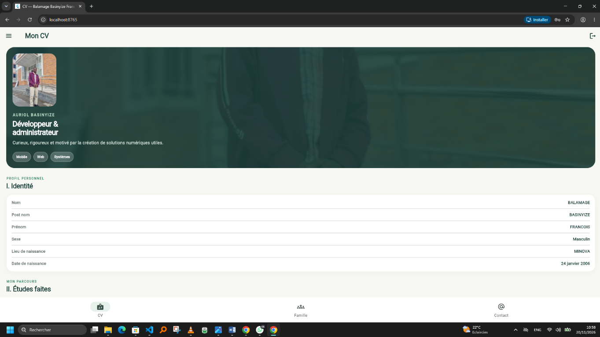
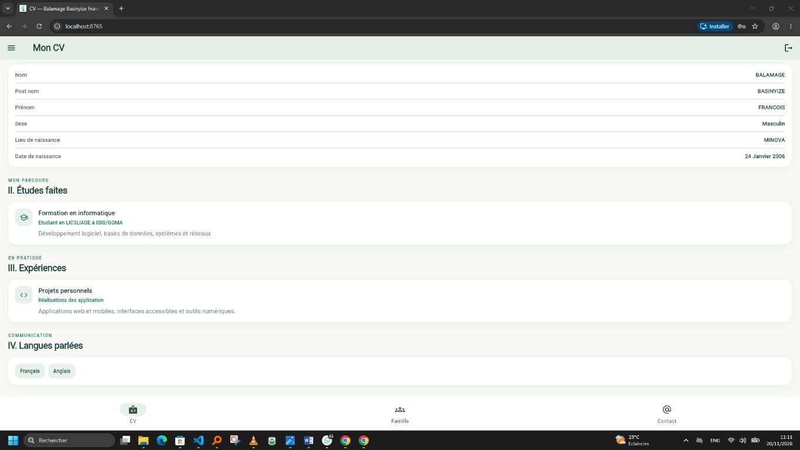
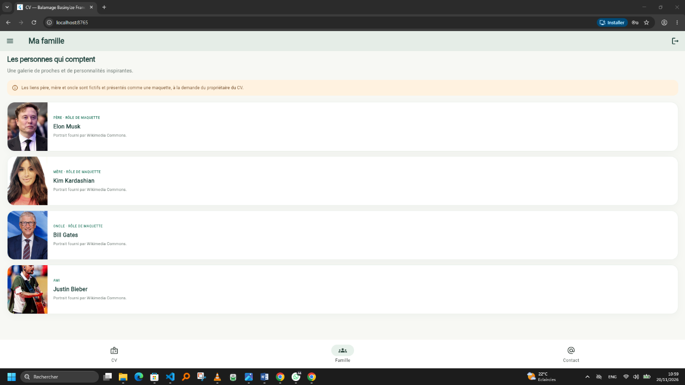
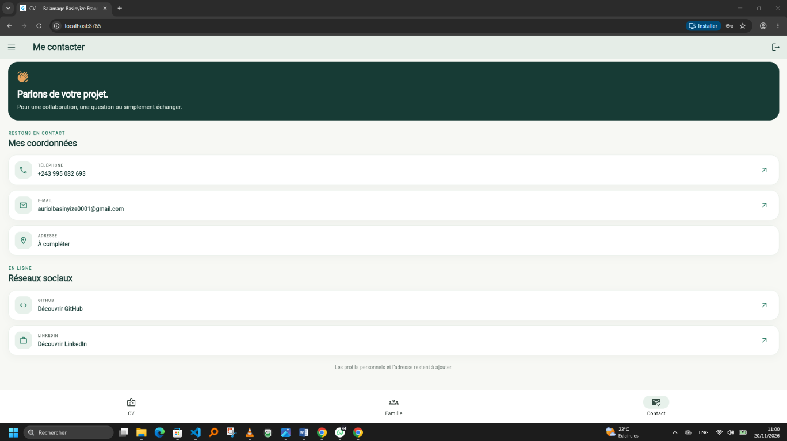

# Projet TP

Application Flutter en français pour gérer un profil, les membres d'une famille
et des étudiants. Les données et les photos sont enregistrées par une API PHP
dans MySQL. Les photos sont choisies par l'utilisateur dans la photothèque du
téléphone.

## Dépôt GitHub

Code source du projet :

https://github.com/nkubamichelle1-glitch/tp-neema-nkuba.git

## Aperçu

### Mon CV





### Ma famille



### Me contacter



## Démarrer l'API PHP et MySQL

Prérequis : PHP 8.1+ avec les extensions `pdo_mysql`, `fileinfo` et `mbstring`,
et un serveur MySQL.

1. Créez le schéma depuis PowerShell :

   ```powershell
   Get-Content -Raw .\backend\database.sql | mysql -u root -p
   ```
2. Configurez les identifiants MySQL (les valeurs par défaut sont `root`, mot
   de passe vide, base `projet_tp`). Dans PowerShell :

   ```powershell
   $env:DB_HOST = "127.0.0.1"
   $env:DB_NAME = "projet_tp"
   $env:DB_USER = "root"
   $env:DB_PASSWORD = "votre-mot-de-passe"
   ```

3. Depuis la racine du projet, démarrez le serveur de développement :

   ```powershell
   php -d upload_max_filesize=6M -d post_max_size=7M `
     -S 0.0.0.0:8000 -t backend\public backend\public\index.php
   ```

Le routeur API est `backend\public\index.php`. Les photos sont écrites dans
`backend\public\uploads\` et doivent être servies par le même hôte que l'API.
Configurez le serveur de production en HTTPS,
augmentez ses limites d'envoi PHP si nécessaire et rendez ce dossier inscriptible
par l'utilisateur PHP. Le trafic HTTP n'est activé que pour faciliter le
développement local ; ne transmettez pas de vrais identifiants sans HTTPS.

## Démarrer Flutter

Pour l'émulateur Android, l'adresse `http://10.0.2.2:8000` est utilisée par
défaut. Lancez l'application avec :

```powershell
flutter pub get
flutter run
```

Pour un téléphone physique, remplacez l'adresse par l'IP locale de l'ordinateur
sur lequel tourne PHP. Pour un serveur déployé, utilisez son URL HTTPS :

```powershell
flutter run --dart-define=API_BASE_URL=https://votre-domaine.example
```

## Routes API

- `POST /auth/register`, `POST /auth/login`, `POST /auth/logout`
- `GET /family`, `POST /family`, `POST /family/{id}`, `DELETE /family/{id}`
- `GET /students`, `POST /students`, `POST /students/{id}`, `DELETE /students/{id}`

Les routes de dossiers nécessitent l'en-tête `Authorization: Bearer <token>`.
Les créations et modifications acceptent les champs en `multipart/form-data`
et une photo facultative nommée `photo` (JPEG, PNG ou WebP, 5 Mo maximum).
